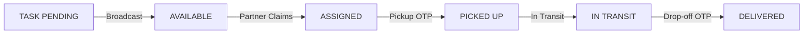

# ShareSphere: Peer-to-Peer Community Borrowing, Lending, and Delivery Coordination Platform

> **“Share More. Own Less. Connect Better.”**  
> *A Full-Stack Solution for Sustainable Community Resource Sharing*

---

## 1. Project Overview & Motivation

In modern urban residential clusters and university campuses, individuals frequently purchase expensive, specialized tangible goods—such as power tools, photography electronics, academic textbooks, camping gear, and event supplies—that sit idle for over 90% of their operational lifespan. Concurrently, peers within the same geographical vicinity frequently encounter short-term requirements for these exact items.

**ShareSphere** solves this issue by providing a production-grade full-stack web platform enabling hyper-local peer-to-peer resource sharing. Registered community members can seamlessly act as both **lenders** and **borrowers** under a single identity, secured by an atomic booking engine, multi-modal fulfillment (self-pickup and crowdsourced delivery partner dispatch), cryptographic OTP-authenticated handovers, and condition verification.

---

## 2. Key Platform Capabilities

- **Symmetrical Dual-Role Identity:** Switch between Borrower and Lender modes under a single user account with unified identity and reputation metrics.
- **Atomic Concurrency-Safe Booking Engine:** Strict ACID-compliant database locking preventing double-bookings and race conditions during simultaneous reservations.
- **Multi-Modal Handover Subsystem:**
  - *Option A: Peer Self-Pickup* (Direct lender-borrower physical exchange).
  - *Option B: Crowdsourced Delivery Partner Dispatch* (Campus/neighborhood peers earn micro-fees coordinating delivery).
- **Verifiable Custody & Condition Logging:** Time-stamped pre/post condition photo uploads coupled with short-lived numeric One-Time Passwords (OTPs) to verify physical item handovers.
- **Administrative Governance & Telemetry:** Central dashboard for listing moderation, audit logs, dispute mediation, and partner approvals.

---

## 3. High-Level System Architecture

The application adopts an **N-Tier Client-Server Architecture**:
1. **Presentation Tier:** React.js Single-Page Application (SPA) styled with Tailwind CSS.
2. **Application Tier:** Java 17+ RESTful API powered by Spring Boot 3.x with Spring Security (stateless JWT), Jakarta Bean Validation, and RBAC authorization.
3. **Data Tier:** Relational MySQL 8.0 managed via Spring Data JPA (Hibernate) with Flyway automated migrations and pessimistic concurrency locks (`@Lock(LockModeType.PESSIMISTIC_WRITE)`).
4. **Third-Party & Media Services:** Cloudinary CDN for condition image hosting and Leaflet/OpenStreetMap for spatial proximity.

```
       ┌────────────────────────────────────────────────────────┐
       │                Client Layer (React.js)                 │
       │   [Borrower Views]  [Lender Views]  [Delivery Portal]  │
       └───────────────────────────┬────────────────────────────┘
                                   │ HTTPS / REST (JSON)
                                   ▼
       ┌────────────────────────────────────────────────────────┐
       │            Backend API (Java / Spring Boot 3)          │
       │  • Spring Security (JWT)     • Atomic Booking Engine   │
       │  • Delivery Dispatch Queue   • OTP Handover Validator  │
       └───────────────────────────┬────────────────────────────┘
                                   │ Spring Data JPA / Hibernate
                                   ▼
       ┌────────────────────────────────────────────────────────┐
       │           Persistence Layer (MySQL 8.0)                │
       │  Users │ Items │ Bookings │ Deliveries │ ConditionLogs │
       └────────────────────────────────────────────────────────┘
```

> Architectural diagrams, block diagrams, and state flowcharts are located in [docs/diagrams/](docs/diagrams/).

---

## 4. Repository Structure

```text
sharesphere/
│
├── .github/                           # GitHub CI/CD workflows and PR templates
│   └── workflows/
│       ├── ci-backend.yml             # API build & automated test runner
│       └── ci-frontend.yml            # React build & lint verification
│
├── docs/                              # Academic & Technical Documentation
│   ├── diagrams/                      # Architecture, block, flowchart & ER diagrams
│   ├── srs/                           # Software Requirements Specification (SRS)
│   ├── api/                           # OpenAPI / Postman collection specs
│   ├── ShareSphere_Project_Synopsis.docx
│   └── ShareSphere_Project_Synopsis.pdf
│
├── client/                            # React.js Frontend (Vite + Tailwind CSS)
│   ├── public/                        # Static assets, favicon, logos
│   ├── src/
│   │   ├── assets/                    # Icons and illustrations
│   │   ├── components/                # Modular reusable UI widgets
│   │   │   ├── common/                # Navbar, Footer, Modal, Button, Badge
│   │   │   ├── item/                  # ItemCard, ItemGrid, CategoryFilter
│   │   │   ├── booking/               # CalendarRangePicker, PriceSummary
│   │   │   ├── delivery/              # DeliveryTimeline, OTPModal
│   │   │   └── admin/                 # TelemetryCard, ModerationTable
│   │   ├── context/                   # Global state (AuthContext, AlertContext)
│   │   ├── hooks/                     # Custom hooks (useAuth, useFetch)
│   │   ├── layouts/                   # MainLayout, DashboardLayout
│   │   ├── pages/                     # Routed screen components
│   │   │   ├── Dashboard/             # Lending & Borrowing management
│   │   │   ├── DeliveryPortal/        # Crowd delivery task execution
│   │   │   ├── Admin/                 # Administrative metrics & moderation
│   │   │   ├── Home.jsx
│   │   │   ├── Catalog.jsx
│   │   │   └── ItemDetails.jsx
│   │   ├── services/                  # Axios HTTP client API instances
│   │   └── utils/                     # Formatting utilities & validation schemas
│   ├── .env.example
│   ├── package.json
│   └── vite.config.js
│
├── server/                            # Backend REST API (Reserved for Backend Lead to build from scratch)
│   └── .gitkeep
│
├── .gitignore                         # Project-wide git exclusion rules
├── docker-compose.yml                 # One-click multi-container orchestration
└── README.md                          # Master project documentation
```

---

## 5. Team Roles & Feature Branch Allocation

To maintain strict modularity, clean Git histories, and prevent merge conflicts across the 4 student team members, the repository follows a structured branch assignment matrix:

```
                    ┌───────────────────────────┐
                    │       main (Prod)         │
                    └─────────────▲─────────────┘
                                  │ (Milestone Releases)
                    ┌─────────────┴─────────────┐
                    │      develop (Stage)      │
                    └──────▲──────▲──────▲──────┘
                           │      │      │
         ┌─────────────────┘      │      └─────────────────┐
         │                        │                        │
  [feat/ui-*]              [feat/api-*]             [feat/db-*]
  (Frontend Lead)       (Backend Lead)           (Database Lead)
```

### Role-to-Branch Responsibility Matrix

| Team Member Role | Primary Technical Responsibility | Assigned Feature Branch Namespace | Key Deliverables & Modules Owned |
| :--- | :--- | :--- | :--- |
| **Frontend Lead & UI/UX Architect** | Design of responsive React interfaces, Tailwind styling, state management, and user views. | `feat/ui-*` | • `feat/ui-auth-shell`: Login, Register & Protected Routes<br>• `feat/ui-item-catalog`: Browse, search, category filters<br>• `feat/ui-booking-flow`: Interactive date range picker & pricing<br>• `feat/ui-delivery-portal`: Task queue, status update & OTP modal<br>• `feat/ui-admin-dashboard`: Moderation tables & metrics |
| **Backend & Security Lead** | Spring Boot REST controllers, Spring Security 6, JWT filter, BCrypt hashing, and Jakarta validation. | `feat/api-*` | • `feat/api-jwt-security`: Spring Security configuration, JWT filter & UserDetails<br>• `feat/api-item-crud`: Listing creation, search and category query endpoints<br>• `feat/api-cors-filters`: CORS origin policy, global exception advice & rate limiting<br>• `feat/api-admin`: Admin audit logging and listing moderation services |
| **Database & Concurrency Architect** | MySQL schema, JPA Entities, Hibernate relationships, Flyway migrations, and ACID locks. | `feat/db-*` | • `feat/db-schema-flyway`: Flyway SQL baseline migrations (V1__init_schema.sql)<br>• `feat/db-atomic-booking`: Pessimistic locking queries (`@Lock(PESSIMISTIC_WRITE)`)<br>• `feat/db-indexing-optimization`: Proximity and date query tuning<br>• `feat/db-entities-jpa`: Hibernate entity relationships and cascading |
| **Logistics, QA & Documentation Lead** | Delivery partner workflows, OTP verification logic, Cloudinary CDN integration, and JUnit 5 tests. | `feat/service-*`<br>`feat/tests-*`<br>`docs/*` | • `feat/service-delivery-otp`: Cryptographic 6-digit OTP engine<br>• `feat/service-cloudinary-cdn`: Item & condition photo pipeline<br>• `feat/tests-concurrency`: JUnit 5 / MockMvc suite for race-condition verification<br>• `docs/srs-api-spec`: SRS, OpenAPI specifications, and final report |

---

## 6. Git Branching & Contribution Workflow

1. **Pull Latest Changes:**
   ```bash
   git checkout develop
   git pull origin develop
   ```

2. **Create a Dedicated Feature Branch:**
   ```bash
   # Pattern: <category>/<feature-name>
   git checkout -b feat/ui-booking-flow
   ```

3. **Commit with Conventional Commit Format:**
   ```text
   feat: add calendar date range picker with unavailable date disabled
   fix: prevent negative daily rate input on item creation
   docs: update ER diagram with cascade delete relations
   test: add concurrency test for simultaneous booking requests
   ```

4. **Push & Open a Pull Request (PR):**
   - Push to `origin feat/<branch-name>`.
   - Open a PR targeting the **`develop`** branch (never directly to `main`).
   - Require at least **1 peer review** from another team member before merging.
   - Tag the respective lead role responsible for verification ownership.

---

## 7. Local Development Setup Guide

### Prerequisites
- **Java Development Kit (JDK)**: v17 LTS or higher
- **Node.js**: v20.x or higher & **npm**: v10.x or higher
- **MySQL Server**: v8.0 or Docker installed

---

### Step 1: Database Setup (MySQL)
Create a new MySQL database for local development:
```sql
CREATE DATABASE sharesphere_db;
```

---

### Step 2: Backend Setup
> *The backend module is currently assigned to the Backend Lead for implementation from scratch in `server/`.*
> *Once the backend scaffolding is pushed, start the service here.*

---

### Step 3: Frontend Setup
```bash
cd ../client

# Install frontend dependencies
npm install

# Configure environment variables
cp .env.example .env

# Start frontend development server
npm run dev
```
*Frontend application will run at `http://localhost:5173`.*

---

### Step 4: (Alternative) One-Click Docker Setup
To run MySQL, Backend, and Frontend in synchronized containers:
```bash
docker-compose up --build
```

---

## 8. State Lifecycle Dynamics

### 1. Booking State Transition


- **Happy Path:** `PENDING` ➔ `CONFIRMED` ➔ `ACTIVE` ➔ `RETURNED` ➔ `COMPLETED`
- **Exceptions & Terminations:** `REJECTED`, `CANCELLED`, `OVERDUE`, `DISPUTED`

### 2. Delivery Partner Task Lifecycle


- **Task Pipeline:** `TASK_PENDING` ➔ `AVAILABLE` ➔ `ASSIGNED` ➔ `PICKED_UP` ➔ `IN_TRANSIT` ➔ `DELIVERED`

---

## 9. Academic Deliverables & Timeline Mapping

| Milestone Phase | Implementation Weeks | Core Deliverables |
| :--- | :--- | :--- |
| **Phase 1: Inception & Survey** | Weeks 1 – 2 | Problem statement, feasibility study, and approved synopsis |
| **Phase 2: Modeling & SRS** | Weeks 3 – 4 | UML diagrams, ER schema design, and SRS specification |
| **Phase 3: Auth & Frontend Shell** | Weeks 5 – 6 | JWT authentication, RBAC guards, and responsive React layout |
| **Phase 4: Catalog & Search** | Weeks 7 – 8 | Multi-category item listings, image upload, proximity search |
| **Phase 5: Atomic Booking Engine** | Weeks 9 – 10 | ACID date locking, concurrency testing, and calendar UI |
| **Phase 6: Fulfillment & Logistics**| Weeks 11 – 12 | Delivery partner queue, OTP validation, and condition logs |
| **Phase 7: Governance & Reviews** | Weeks 13 – 14 | Admin telemetry portal, moderation tools, bilateral ratings |
| **Phase 8: Testing & Deployment** | Weeks 15 – 16 | End-to-end integration tests, cloud deployment, final dissertation |

---

## 10. License & Academic Attribution
This project is developed as an undergraduate capstone project in partial fulfillment of the degree of **Bachelor of Technology / Engineering in Computer Science and Engineering**.  
All rights reserved © 2026 ShareSphere Student Project Team.
